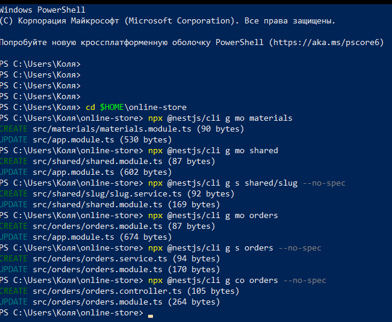
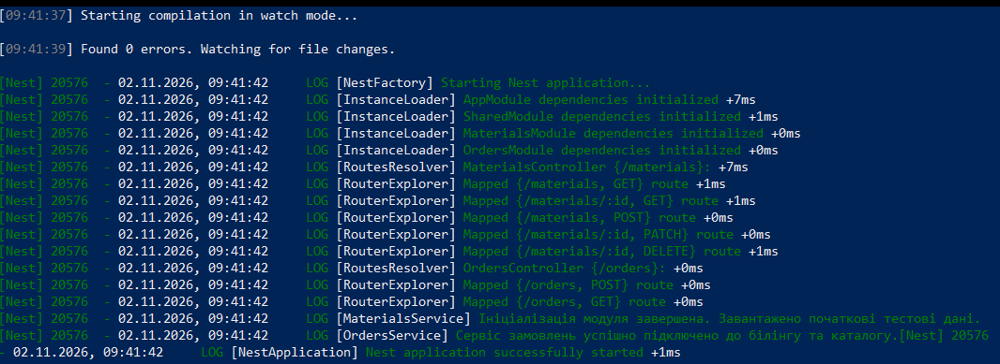
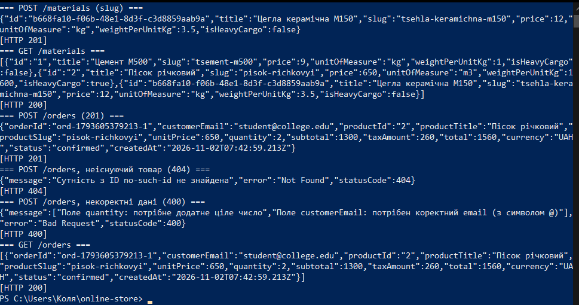
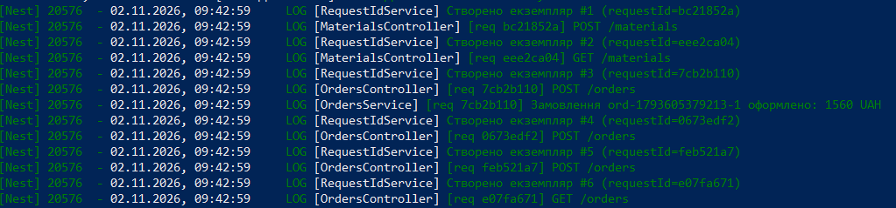

# Практична робота № 5

**Тема:** Модульна архітектура та ін'єкція залежностей (DI) у NestJS

**Виконав:** Дурицький М.М., група КН-43

**Варіант:** 6 (будівельні матеріали, `MaterialEntity`, `MaterialsService`)

Робота продовжує проєкт `online-store` з практичної роботи № 4 (опис попередньої роботи: [репозиторій online-store](https://github.com/Turanabol1/online-store)).

## Опис

Проєкт розбито на функціональні модулі й додано спільний модуль:

- `MaterialsModule` (ресурс `/materials`) експортує `MaterialsService`;
- `SharedModule` містить `SlugService` та кастомні провайдери `STORE_CONFIG` (`useValue`) і `FEE_CALCULATOR` (`useFactory`), а також `RequestIdService` зі `Scope.REQUEST`;
- `OrdersModule` (ресурс `/orders`) імпортує `MaterialsModule` та `SharedModule` і оформлює замовлення з розрахунком податку;
- `AppModule` містить лише імпорт модулів.

Схема залежностей між модулями:

```
AppModule
├── MaterialsModule ──imports──> SharedModule
│     exports: MaterialsService
├── OrdersModule    ──imports──> MaterialsModule, SharedModule
└── SharedModule
      exports: SlugService, STORE_CONFIG, FEE_CALCULATOR, RequestIdService
```

## Середовище

- Windows, PowerShell
- Node.js v22.23.3, npm
- NestJS CLI 12.0.11 (ESM, vitest)
- Visual Studio Code + REST Client (для `requests.http`)

## Структура проєкту

```
src/
├── app.module.ts                          - лише imports: [MaterialsModule, OrdersModule, SharedModule]
├── main.ts
├── materials/
│   ├── materials.module.ts                - imports: [SharedModule], exports: [MaterialsService]
│   ├── materials.controller.ts
│   ├── materials.service.ts               - OnModuleInit, SlugService
│   ├── dto/                               - CreateMaterialDto, UpdateMaterialDto
│   └── entities/material.entity.ts        - MaterialEntity (з полем slug)
├── orders/
│   ├── orders.module.ts                   - imports: [MaterialsModule, SharedModule]
│   ├── orders.controller.ts
│   ├── orders.service.ts                  - MaterialsService + STORE_CONFIG + FEE_CALCULATOR
│   ├── dto/create-order.dto.ts
│   └── entities/order.entity.ts
└── shared/
    ├── shared.module.ts
    ├── request-id.service.ts              - Scope.REQUEST
    ├── slug/slug.service.ts
    └── config/
        ├── app-config.provider.ts         - STORE_CONFIG (useValue)
        └── fee-calculator.provider.ts     - FEE_CALCULATOR (useFactory)
```

## Запуск

```powershell
npm install --legacy-peer-deps
npm run start:dev
```

Запити виконуються з файлу `requests.http` (REST Client у VS Code) на `http://localhost:3000`.

Примітка: `AppController` і `AppService` зі стартового шаблону видалено, бо за умовою в `AppModule` залишаються тільки модулі.

---

## Рівень 1. Feature та Shared модулі

**Генерація через CLI:**

```powershell
npx @nestjs/cli g mo materials
npx @nestjs/cli g mo shared
npx @nestjs/cli g s shared/slug --no-spec
npx @nestjs/cli g mo orders
npx @nestjs/cli g s orders --no-spec
npx @nestjs/cli g co orders --no-spec
```



**Рефакторинг `MaterialsModule`:** контролер і сервіс прибрано з масивів `controllers` / `providers` кореневого `AppModule` і перенесено в `MaterialsModule`; у `AppModule` лишився тільки `imports`.

**`SlugService`** (`generateSlug(title: string): string`) транслітерує українські літери, переводить текст у нижній регістр і замінює все, крім латиниці та цифр, на дефіс (зайві дефіси по краях прибираються): `Цемент М500` дає `tsement-m500`, `Пісок річковий` дає `pisok-richkovyi`. Сервіс зареєстровано в `SharedModule` і додано в `exports`.

**Використання в `MaterialsModule`:** у `imports` додано `SharedModule`, `MaterialsService` отримує `SlugService` через конструктор і при створенні товару записує згенероване поле `slug` у `MaterialEntity` (при зміні `title` через PATCH slug перераховується). `MaterialsService` також вказано в `exports` для `OrdersModule`.

---

## Рівень 2. Кастомні провайдери та міжмодульна взаємодія

**`STORE_CONFIG` (`useValue`)**, файл `shared/config/app-config.provider.ts`:

```ts
export const STORE_CONFIG = 'STORE_CONFIG';

export interface StoreConfig {
  storeName: string;
  defaultCurrency: string;
  taxPercent: number;
}

export const StoreConfigProvider: ValueProvider<StoreConfig> = {
  provide: STORE_CONFIG,
  useValue: { storeName: 'BuildMart', defaultCurrency: 'UAH', taxPercent: 20 },
};
```

**`FEE_CALCULATOR` (`useFactory`)**, файл `shared/config/fee-calculator.provider.ts`:

```ts
export const FeeCalculatorProvider: FactoryProvider<FeeCalculator> = {
  provide: FEE_CALCULATOR,
  useFactory: (config: StoreConfig): FeeCalculator => ({
    calculateTax: (amount: number): number => Math.round(amount * config.taxPercent) / 100,
  }),
  inject: [STORE_CONFIG],
};
```

Фабрика отримує `STORE_CONFIG` через масив `inject` і повертає об'єкт з методом `calculateTax`. Обидва токени експортовано з `SharedModule`.

**`OrdersService`** отримує залежності через конструктор:

```ts
constructor(
  private readonly materialsService: MaterialsService,
  @Inject(STORE_CONFIG) private readonly config: StoreConfig,
  @Inject(FEE_CALCULATOR) private readonly feeCalculator: FeeCalculator,
) {}
```

`@Inject()` потрібен для токенів-рядків, бо інтерфейс `StoreConfig` зникає після компіляції й Nest не може визначити залежність лише за типом.

**Метод `createOrder(dto)`** (`POST /orders`, тіло: `productId`, `quantity`, `customerEmail`):

1. перевіряє дані (`productId` непорожній, `quantity` ціле й додатне, `customerEmail` містить `@`), інакше `400 Bad Request`;
2. шукає товар через `MaterialsService.findOne()`; якщо його немає, кидається `NotFoundException` (`404`);
3. рахує `subtotal = price * quantity`, `taxAmount` через `FEE_CALCULATOR`, `total = subtotal + taxAmount`;
4. валюту бере з `STORE_CONFIG.defaultCurrency`, зберігає замовлення зі статусом `confirmed` і поверненням `201 Created`.

`GET /orders` повертає список оформлених замовлень.

---

## Рівень 3. Lifecycle Hooks та Scope

**`OnModuleInit`:**

- `MaterialsService.onModuleInit()` наповнює сховище двома початковими товарами (цемент, пісок) і виводить через `Logger`: `Ініціалізація модуля завершена. Завантажено початкові тестові дані.`
- `OrdersService.onModuleInit()` виводить: `Сервіс замовлень успішно підключено до білінгу та каталогу.`

**`RequestIdService` зі `Scope.REQUEST`** (`shared/request-id.service.ts`): у конструкторі генерує `requestId` та порядковий номер екземпляра й виводить їх у лог. Сервіс інжектується в `MaterialsController` та `OrdersController`, а контролери пишуть у лог `[req <id>] METHOD /шлях`.

Важливе рішення: `RequestIdService` не інжектується безпосередньо в сервіси. Провайдер зі `Scope.REQUEST` робить request-scoped кожен клас, який його використовує (область видимості «піднімається» вгору по ланцюжку залежностей), а для таких провайдерів Nest не викликає `OnModuleInit`. Тому request-scoped лише контролери, а `requestId` у `OrdersService.createOrder()` передається параметром; сервіси лишаються singleton, і їхні хуки спрацьовують.

---

## Результати тестування

### Запуск сервера

Компіляція без помилок (`Found 0 errors`), ініціалізовано `SharedModule`, `MaterialsModule` та `OrdersModule`, змаплено маршрути `/materials` і `/orders`, спрацювали обидва хуки `OnModuleInit`.



### Перевірка ендпоінтів



| Запит | Результат |
|-------|-----------|
| `POST /materials` («Цегла керамічна М150») | `201`, згенеровано `slug: tsehla-keramichna-m150` |
| `GET /materials` | `200`, два стартових товари із `slug` (`tsement-m500`, `pisok-richkovyi`), додані в `OnModuleInit`, і створений товар |
| `POST /orders` (товар `2`, кількість 2) | `201`, `subtotal` 1300, `taxAmount` 260 (20% з `STORE_CONFIG`), `total` 1560, `currency` UAH, `status: confirmed` |
| `POST /orders` з неіснуючим `productId` | `404`, `"Сутність з ID no-such-id не знайдена"` |
| `POST /orders` з `quantity: 0` та email без `@` | `400`, список помилок по полях `quantity` та `customerEmail` |
| `GET /orders` | `200`, одне оформлене замовлення |

### Поведінка Scope.REQUEST

У консолі сервера для кожного HTTP-запиту з'являється новий екземпляр `RequestIdService` (`#1`, `#2`, ..., `#6`) з власним `requestId`, а контролери логують запит із цим id. Один запит `POST /orders` проходить через один `requestId` в контролері та в `OrdersService`.



---

## Відповіді на контрольні питання

**1. Що таке Feature Module та Shared Module?**
Feature Module групує код однієї предметної області (контролери, сервіси, DTO), наприклад `MaterialsModule` та `OrdersModule`, і робить застосунок модульним. Shared Module містить спільні для кількох модулів провайдери (утиліти, конфігурація), які експортуються й повторно використовуються, щоб не дублювати код: у роботі це `SharedModule` із `SlugService`, `STORE_CONFIG` та `FEE_CALCULATOR`.

**2. Як працює інкапсуляція провайдерів? Що буде без `exports`?**
Провайдери за замовчуванням приватні для свого модуля. Щоб інший модуль міг їх використати, власник має вказати провайдер у `exports`, а споживач додати цей модуль у `imports`. Якщо сервіс іншого модуля не експортований, Nest під час запуску кине помилку `Nest can't resolve dependencies of the X (?)` з порадою перевірити, чи доступний цей провайдер у контексті модуля, і застосунок не стартує.

**3. Різниця між `useClass`, `useValue` та `useFactory`.**
`useClass` (стандартний варіант) створює екземпляр указаного класу контейнером. `useValue` підставляє готове значення або об'єкт, наприклад конфігурацію, без створення. `useFactory` викликає функцію, яка повертає значення, і може отримувати інші залежності через `inject`, тому її використовують, коли об'єкт залежить від налаштувань або створюється за логікою.

**4. Для чого `@Inject()`? Коли автоматична ін'єкція за типом неможлива?**
`@Inject(token)` явно вказує токен залежності. Він потрібен, коли токен є рядком або символом (`STORE_CONFIG`, `FEE_CALCULATOR`), а також коли тип є інтерфейсом чи простим типом, який не існує під час виконання, тому Nest не може ідентифікувати залежність за типом у конструкторі.

**5. Як працює масив `inject` у `useFactory`?**
Це список токенів провайдерів, значення яких контейнер розв'язує й передає у фабричну функцію як аргументи в тому самому порядку. У роботі `inject: [STORE_CONFIG]` передає конфігурацію першим параметром `useFactory: (config: StoreConfig) => ...`.

**6. Що таке життєвий цикл компонента? Коли спрацьовує `OnModuleInit`?**
Це послідовність подій: створення й розв'язання залежностей, ініціалізація модулів, запуск, а потім завершення роботи (хуки `OnModuleInit`, `OnApplicationBootstrap`, `OnModuleDestroy`, `OnApplicationShutdown` тощо). `onModuleInit()` викликається один раз, коли залежності модуля розв'язано, до початку прийому запитів. У ньому рекомендовано виконувати початкове налаштування: наповнення стартовими даними, перевірку підключень, прогрів кешу. Для request-scoped провайдерів цей хук не викликається.

**7. `Scope.DEFAULT` проти `Scope.REQUEST` та `Scope.TRANSIENT`.**
`Scope.DEFAULT` (singleton): один екземпляр на весь застосунок. `Scope.REQUEST`: новий екземпляр на кожен HTTP-запит, який знищується після відповіді, і така область «піднімається» вгору по залежностях (споживачі теж стають request-scoped). `Scope.TRANSIENT`: кожен споживач отримує власний екземпляр, який створюється разом із ним і не залежить від кількості запитів. У нашому тесті `Scope.REQUEST` дав окремий екземпляр (`#1`...`#6`) на кожен запит.

**8. Що таке циклічна залежність між модулями і як її розв'язати?**
Це ситуація, коли модуль A імпортує B, а B імпортує A (або провайдери залежать один від одного), тому Nest не може побудувати граф залежностей. Розв'язується функцією `forwardRef()`: у `imports` обох модулів (`imports: [forwardRef(() => BModule)]`) і, для провайдерів, у `@Inject(forwardRef(() => ServiceB))`. Краще рефакторити, винісши спільну частину в окремий модуль.

---

## Висновки

Проєкт розбито на модулі `MaterialsModule`, `OrdersModule` та `SharedModule` з експортом і імпортом сервісів через метадані `@Module`. Створено кастомні провайдери `STORE_CONFIG` (`useValue`) та `FEE_CALCULATOR` (`useFactory` з `inject`) і використано їх через `@Inject()` у `OrdersService` для розрахунку податку та суми замовлення. Реалізовано хуки `OnModuleInit` у двох сервісах і досліджено `Scope.REQUEST` (новий екземпляр на кожен запит). Усі сценарії перевірено запитами, результати наведено вище.
